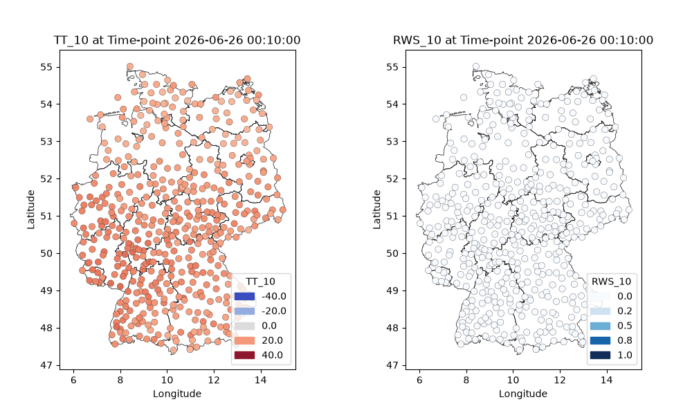

# Weather data visualization

Jupyter Notebooks for downloading, processing and visualizing weather data provided by the [German Weather Service (DWD) / Open Data](https://www.dwd.de/DE/leistungen/opendata/opendata.html) (licensed [CC-BY 4.0](https://creativecommons.org/licenses/by/4.0/deed.en), [read more](https://www.dwd.de/EN/service/legal_notice/legal_notice_node.html)) and maps provided by [Registry of Open Data on AWS](https://registry.opendata.aws/naturalearth/). The used data was republished on Huggingface [here](https://huggingface.co/datasets/haesleinhuepf/dwd_temperature_july2026) and [here](https://huggingface.co/datasets/haesleinhuepf/dwd_precipitation_july2026).

The data covers the heatwave in Germany in June 2026.



## Installation

Download this repository and install dependencies:

```
git clone https://github.com/haesleinhuepf/weather
cd weather
pip install -r requirements.txt
```

## Download data

Run the [download_huggingface.ipynb](download_huggingface.ipynb) notebook. 

Also execute the [download_maps.ipynb](download_maps.ipynb) notebook to store GeoJson data of [outlines of Germany](germany_outline.json) and its [federal states](germany_federal_states.json).

Optionally, you can also download the data from DWD directly. This is recommended, if you want to plot more recent data than from the beginning of July 2026. In this case, use [download_dwd.ipynb]. It will create folders such as `temp_recent` and/or `rain_recent` containing temperature and rain data from [here](https://opendata.dwd.de/climate_environment/CDC/observations_germany/climate/10_minutes/air_temperature/recent/) or [here](https://opendata.dwd.de/climate_environment/CDC/observations_germany/climate/10_minutes/precipitation/recent/). 
You can then [convert this data to parquet](convert_parquet.ipynb) and optionally upload it to huggingface. Note: When publishing DWD data, please respect [DWDs copyright notice](https://www.dwd.de/EN/service/legal_notice/legal_notice_node.html).

## Visualizing timelapse data on maps

In the [plot_day.ipynb](plot_day.ipynb) and [plot_weeks.ipynb](plot_weeks.ipynb) notebooks we use [geopandas](https://geopandas.org/en/stable/), [seaborn](https://seaborn.pydata.org/) and [stackview](https://github.com/haesleinhuepf/stackview) to visualize weather data on top of map data as animated Gifs.

## Remarks

Large parts of the code provided here was AI generated using ChatGPT / GPT5 and [bia-bob](https://github.com/haesleinhuepf/bia-bob) using the `claude-4.6-sonnet` model.
